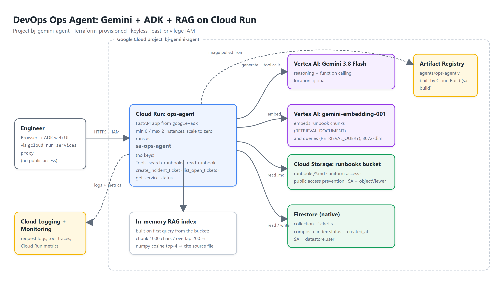

# Gemini RAG + ADK Ops Agent on Cloud Run

[](demo/demo.mp4)

A DevOps on-call assistant built with Google's **Agent Development Kit (ADK)** and **Gemini on Vertex AI**. It answers operational questions from Markdown runbooks (RAG with Vertex AI embeddings), opens and lists incident tickets in **Firestore**, and reports mock service health. It runs on **Cloud Run** as a dedicated, keyless service account; everything is provisioned with **Terraform** and the image is built by **Cloud Build**.

- Demo video: [`demo/demo.mp4`](demo/demo.mp4) · captions [`demo/captions.srt`](demo/captions.srt) · transcript [`demo/transcript.md`](demo/transcript.md)
- Project: `bj-gemini-agent` · region `us-central1` · Gemini served from the `global` Vertex AI location
- **Rebuild from scratch, step by step (incl. org-policy and teardown): [`REBUILD.md`](REBUILD.md)**

## What it does

| Capability | How |
|---|---|
| Runbook Q&A with citations | `search_runbooks` embeds the question (`gemini-embedding-001`, `RETRIEVAL_QUERY`) and runs cosine similarity over runbook chunks; `read_runbook` returns the full document so the answer has complete, ordered steps and cites `(source: file.md)`. |
| Incident tickets | `create_incident_ticket(title, severity, summary)` and `list_open_tickets()` on the Firestore `tickets` collection (composite index on `status` + `created_at`). |
| Service health | `get_service_status(service)` mock status API, same signature you would wire to Cloud Monitoring uptime checks. |
| Guardrails | The instruction forces search → read → answer, forbids inventing commands, validates severity (P1-P4) and surfaces backend errors to the model instead of crashing the turn. |

Model: `gemini-3.8-flash` (latest Flash at build time; set `GEMINI_MODEL` to change).

## Architecture


```
Engineer ─(gcloud run services proxy, IAM token)─► Cloud Run: ops-agent (ADK FastAPI + web UI)
                                                     │ service account: sa-ops-agent (no keys)
                                                     ├─► Vertex AI Gemini (global)         reasoning + function calling
                                                     ├─► Vertex AI gemini-embedding-001     RAG embeddings
                                                     ├─► GCS bucket (private)              runbooks/*.md
                                                     └─► Firestore (native)                tickets
```

## Repository layout

```
app/                      container: ADK FastAPI app (main.py) + agent package
  ops_agent/agent.py      root_agent = Agent(model, instruction, tools=[...])
  ops_agent/rag.py        load (GCS or local) → chunk → embed → in-memory cosine search
  ops_agent/tickets.py    Firestore tools
  ops_agent/status.py     mock status tool
  test_agent.py           run the agent from the CLI with the ADK Runner
runbooks/                 5 sample runbooks (CouchDB recovery, release rollback, DB migration, TLS, disk full)
terraform/                APIs, service accounts + IAM, bucket + objects, Firestore + index, Artifact Registry, Cloud Run
cloudbuild.yaml           image build with a dedicated build service account (CLOUD_LOGGING_ONLY)
deploy.sh                 two-phase apply (registry → build → Cloud Run)
demo/                     recorder.py + scenes.py: automated demo video with Cloud Text-to-Speech narration
docs/                     architecture diagram (HTML source + PNG)
```

## Run locally

```bash
python -m venv .venv && source .venv/bin/activate
pip install -r app/requirements.txt
export GOOGLE_GENAI_USE_VERTEXAI=TRUE GOOGLE_CLOUD_PROJECT=<project> GOOGLE_CLOUD_LOCATION=global
gcloud auth application-default login
cd app && adk web            # UI at http://localhost:8000
# or: python test_agent.py "CouchDB crashed on prod, what are the recovery steps?"
```

Without `RUNBOOKS_BUCKET` the agent reads `runbooks/` from disk; on Cloud Run it reads the bucket.

## Deploy

```bash
cp terraform/terraform.tfvars.example terraform/terraform.tfvars   # set project_id
./deploy.sh v1
gcloud run services proxy ops-agent --region us-central1 --port 8080   # open http://localhost:8080/dev-ui/
```

`deploy.sh` applies the registry, build account and Firestore first, builds the image with Cloud Build, then applies the rest (Cloud Run needs the image to exist).

## Security

- Dedicated runtime SA `sa-ops-agent`: `roles/aiplatform.user`, `roles/datastore.user` at project level, `roles/storage.objectViewer` on the bucket only. No editor/owner.
- No service account keys. Cloud Run uses the attached SA; locally you use your own ADC login.
- Cloud Run has **no `allUsers` invoker**; an unauthenticated request returns 403. Access is through `gcloud run services proxy` (or IAP).
- Bucket: uniform bucket-level access, public access prevention enforced.
- Cloud Build runs as `sa-build` (Artifact Registry writer + log writer + object viewer), not the default build SA.
- The container runs as a non-root user.

## Cost and cleanup

Cloud Run scales to zero; Gemini Flash + embeddings for a demo cost a few rupees; Firestore and GCS stay in the free tier.

```bash
./teardown.sh        # terraform destroy + report of anything left; ./audit-billing.sh lists everything billable
```

## Design notes (interview talking points)

- **Why ADK:** typed function tools from plain Python, session/state handling, a dev UI with event and trace views, `adk eval`, and the same app object deploys to Cloud Run or Agent Engine.
- **RAG choices:** 1000-char chunks with 200 overlap, top-4, then a second tool reads the whole runbook so procedures are never truncated. In-memory numpy is right for tens of documents; at scale move to Vertex AI RAG Engine or BigQuery vector search and add re-ranking.
- **Embedding gotcha found while building:** on Vertex AI `gemini-embedding-2` returned a single vector for a batched request, which silently collapsed the index to one chunk. `rag.py` now asserts `len(vectors) == len(texts)` and uses `gemini-embedding-001`.
- **Model location:** Gemini 3.x models are served from the `global` Vertex AI location; embeddings and the rest of the stack stay in `us-central1`.
- **Keyless auth everywhere:** attached SA on Cloud Run, ADC locally, dedicated build SA in Cloud Build; the org policy `iam.disableServiceAccountKeyCreation` would block keys anyway.
- **Cost controls:** scale-to-zero, max 2 instances, Flash-class model, embeddings computed once per instance and cached in memory.

## How I built this

Code, Terraform and the demo pipeline were written with Claude Code; model selection, the RAG tool design (search → read), the embedding-batch bug, IAM scoping and the Cloud Run proxy flow were worked out by testing against the real project. Narration uses Google Cloud Text-to-Speech (Chirp 3 HD).
